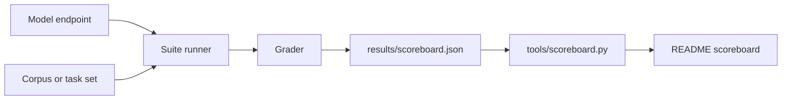

# assay

Eval suites that measure language models, with every result published.

`assay` runs models through the same suites on the same hardware, against
public benchmarks and against one operator's real workloads, and publishes
what it measured whether or not it is flattering. It is for anyone picking a
model for a real job who wants a measured answer instead of a vendor claim.

## What it does

1. A suite runs one model against its corpus or task set and grades the
   output: macro extraction, an unattended coding ticket, an in-character
   reply, a serving contract.
2. The numbers someone stands behind go into that suite's
   `results/scoreboard.json`, each with its date and its caveat.
3. `tools/scoreboard.py` renders those files into the [Scoreboard](#scoreboard)
   below, and CI fails when the README and the files disagree.

## Quick start

```sh
git clone https://github.com/quadseven/assay
cd assay
uv sync --locked
uv run pytest -q   # the parts that need no model and no corpus
```

Installing dependencies needs network access. The tests need no model server
or downloaded benchmark corpus. To run a benchmark you also need a model
endpoint and the corpus. For the nutrition suite:

```sh
# 1. Fetch NutriBench (CC-BY-NC-SA-4.0, not redistributed here) from
#    huggingface.co/datasets/dongx1997/NutriBench into
#    suites/nutrition/data/nutribench/ (v2/train-00000-of-00001.parquet).

# 2. Point at any Ollama host and run 5 rows.
cd suites/nutrition
OLLAMA_BASE_URL=http://localhost:11434 \
  uv run python nutribench_runner.py --model llama3.2:3b --split v2 --max-rows 5
```

The runner prints per-axis pass rate, MAE, MAPE and latency, and exits
non-zero if the corpus is missing rather than silently scoring nothing.

## How it works



A suite owns its corpus, its runner and its grader. The runner sends each
prompt or task to the model endpoint; the grader scores the answer. Curated
measurements go into the suite's `results/scoreboard.json`, and
`tools/scoreboard.py` is the only thing that writes the table below. Raw run
archives stay gitignored.

| Suite | What it asks |
|---|---|
| [`suites/agentic_coding/`](suites/agentic_coding/) | Can a model work a real backlog ticket unattended? The current catalog contains 9 tasks, each with a hidden test, and a contained runner. |
| [`suites/spark_serving/`](suites/spark_serving/) | Does a served model hold `json_object`, `tool_calling` and `vision`, and how fast does it decode? |
| [`suites/nutrition/`](suites/nutrition/) | NutriBench macro extraction: base, RAG, chain-of-thought and cloud arms. |
| [`suites/persona_chat/`](suites/persona_chat/) | Is a model usable as an in-character voice, fast enough for a player? |
| [`suites/loom_lanes/`](suites/loom_lanes/) | How does each Loom lane's model do on real Loom tickets? Reads GitHub; runs no model. |
| [`suites/loom_gates/`](suites/loom_gates/) | Do the gates between a lane's pull request and a merge stop the right ones? Replays real cases. |
| [`suites/lane_review/`](suites/lane_review/) | Does the review bot stop the lane pull requests that did damage, and only those? |
| [`suites/review_quality/`](suites/review_quality/) | Which model should review pull requests, measured rather than picked by hand. |

[`suites/README.md`](suites/README.md) describes how to add a suite.

## Run and test locally

```sh
uv sync --locked
uv run pytest -q && uv run --extra llmobs python -c 'import ddtrace' && uv run --extra llmobs pytest tests/test_optional_telemetry_security.py tests/test_ddtrace_redaction_security.py -q
uvx ruff@0.15.10 check .
uvx ruff@0.15.10 format --check .
python3 tools/leakscan.py --selftest
python3 tools/leakscan.py .
```

CI runs the same commands on every pull request (`.github/workflows/ci.yml`).
`uv run pytest -q` includes `tests/test_scoreboard.py`, which fails when the
table below no longer matches the suites' `results/scoreboard.json` files.

## Configuration

Nothing is needed for the test suite. Running a benchmark needs a model to
measure; these are the settings the suites read:

| Setting | Where | What it does |
|---|---|---|
| `OLLAMA_BASE_URL` | environment | Ollama host for the nutrition runners (default `http://localhost:11434`). |
| `OLLAMA_TIMEOUT` | environment | Per-request timeout in seconds for those runners. |
| `OFF_PARQUET_PATH` | environment | Open Food Facts parquet for the RAG arm (`off_parquet.py` has the default). |
| `OFF_PARQUET_OPTIONAL` | environment | Set to `1` only to permit empty retrieval when the dump is absent; this does not measure a working RAG arm. |
| `POOLSIDE_API_KEY`, `OPENROUTER_API_KEY`, `ANTHROPIC_API_KEY`, `GEMINI_API_KEY`, `OPENAI_API_KEY` | environment | Keys for the nutrition cloud arm; only the provider you pick is read. |
| `OPENCODE_GO_API_KEY` | environment | Key for the review_quality runner. |
| `LR_GATEWAY_URL`, `LR_DEBUG` | environment | Gateway required by lane_review pipeline mode; optional debug output when `LR_DEBUG` is set. |
| `DD_LLMOBS_ENABLED`, `DD_API_KEY` | environment | Optional nutrition telemetry: enable it and supply a Datadog key after installing the `llmobs` extra. Leave disabled for ordinary benchmarks. |
| `DD_LLMOBS_ML_APP`, `DD_SITE` | environment | Optional telemetry app and site (defaults `nutribench-eval` and `datadoghq.com`). |
| `OPENROUTER_REFERER` | environment | Optional cloud-arm request attribution (defaults to this public repository URL). |
| `--url`, `--model` | command line | Endpoint and model for the spark_serving and persona_chat probes. |
| `--agent`, `--label`, `--endpoint` | command line | Required agent command, result label and model-server `HOST:PORT` for agentic_coding. |
| `--env`, `--endpoint-model` | command line | Pass the agent its proxy address through `{endpoint_host}` and `{endpoint_port}` in `--env` values; set the wire model when it differs from the label. |
| `--base-url`, `--models` | command line | Optional review_quality endpoint and served model IDs; hosted runs require `OPENCODE_GO_API_KEY`. |
| `--repo`, `--rescore` | command line | loom_lanes needs target repositories and authenticated `gh`, or a saved collection to rescore. |
| `--grug`, `--loom` | command line | Local source checkouts required by loom_gates replay; lane_review accepts `--grug` or recorded `--live` verdicts. |

Settings are supplied through the environment or command-line flags; there is
no configuration file to copy. No model server, agent CLI, replay checkout,
benchmark dump or GitHub credentials ship with the repository. Agentic coding
requires `sandbox-exec` on macOS or `bwrap` on Linux; Windows is not a supported
benchmark runner. See [the runner examples](suites/agentic_coding/README.md#reproduce-it)
for the agent-specific proxy variables.

Download `v2/train-00000-of-00001.parquet` from the
[NutriBench dataset](https://huggingface.co/datasets/dongx1997/NutriBench)
into `suites/nutrition/data/nutribench/v2/` for the nutrition quick start.
The RAG arm additionally needs an Open Food Facts parquet dump containing
the columns read by [`off_parquet.py`](suites/nutrition/off_parquet.py);
set `OFF_PARQUET_PATH` to your local copy. No dump fetcher ships here.

## Status

Open work is tracked in
[the assay epic](https://github.com/quadseven/assay/issues/56).

## Contributing

Changes land through a pull request; direct pushes to `main` are refused. A
pull request must pass `ci.yml` (install, ruff, pytest and the leak scan),
`check.leak-scan.yml` (the shared public-repo leak scan over the diff and the
pull request text) and the review bot's checks. Read [AGENTS.md](AGENTS.md)
first: this repository is public.

## Scoreboard

Every number below was measured here, on this hardware, by the suite named in
its row. **Vendor and aggregator claims are never recorded as results**, so a
blank cell means "not run", never "not good".

<!-- scoreboard:begin -->

| Model | Where it runs | Agentic coding | Nutrition (mean MAPE) | In-character chat | Serving contracts / decode |
|---|---|---|---|---|---|
| `Qwen/Qwen3.6-35B-A3B-FP8` | local, vLLM | void: measured before reads were contained: the hidden test was readable to the agent | -- | -- | 3/3, 64.8 tok/s |
| `Qwen/Qwen3.8-27B (Ollama qwen3.8:27b-mtp-q8_0)` | local, Ollama, single node | 2/2 valid, 97s/task | -- | -- | 3/3, 21.6 tok/s |
| `Qwen/Qwen3.8-Flash-Next (unsloth UD-IQ4_XS GGUF)` | local, Ollama, single node | 6/6, 79s/task | -- | 3/4, 7.4s/reply | 2/3, 27.5 tok/s |
| `deepseek-ai/DeepSeek-V4-Flash-0731` | local, vLLM, TP=2 across BOTH nodes | void: measured before reads were contained: the hidden test was readable to the agent | -- | -- | 2/3, 61.8 tok/s |
| `gemma4:31b` | local, Ollama | void: server never loaded the model (fleet context 262k x 8 slots) | -- | -- | -- |
| `gpt-oss:120b` | local, Ollama | void: measured before reads were contained: the hidden test was readable to the agent | -- | -- | -- |
| `llama3.2:3b` | local, Ollama | -- | ~53% | -- | -- |
| `mistral-small:24b` | local, Ollama | -- | 35%, 15.6% energy with a scratchpad | 4/4, 9.5s/reply | -- |
| `nemotron-3-nano:30b-a3b-q4_K_M` | local, Ollama, single node, via the Anthropic bridge | 2/6, 33s/task | -- | 4/4, 6.0s/reply | -- |
| `nemotron-3-super:120b` | local, Ollama | void: harness defect: tasks 2-6 shared the box with orphaned attempts | -- | -- | -- |
| `nemotron-3.5-lightning:30b` | local, Ollama, single node | 6/6, 35s/task | -- | 4/4, 12.2s/reply | 2/3, 91.9 tok/s |
| `nemotron-3.5-lightning:30b (opencode harness)` | local, Ollama, single node | 4/6, 50.6s/task | -- | -- | -- |
| `nvidia/NVIDIA-Nemotron-3.5-Super-VL-120B-A12B-NVFP4 (opencode harness)` | local, vLLM (the model card's single-GPU recipe: LiLiCorr dflash drafter, 7 speculative tokens, one sequence), single node | 6/6, 47.6s/task | -- | -- | -- |
| `poolside/laguna-m.1` | cloud | -- | 32.5%, 17.7% energy | -- | -- |
| `poolside/laguna-xs.2` | cloud | -- | 30.8% | -- | -- |
| `qwen2.5:32b` | local, Ollama | -- | 53% | -- | -- |
| `qwen3-coder-next:q4_K_M (opencode harness)` | local, Ollama, single node | 6/6, 20.5s/task | -- | -- | -- |
| `qwen3-coder-next:q8_0` | local, Ollama | void: measured before reads were contained: the hidden test was readable to the agent | -- | -- | -- |
| `qwen3.6:35b` | local, Ollama | void: wrote into another repo's checkout mid-sweep; the grader cannot see that | -- | -- | -- |
| `unsloth/Qwen3.8-27B-NVFP4` | local, vLLM | -- | -- | -- | 3/3, 20.3 tok/s |

`--` means **not run**, never *not good*. Every number was measured
on this hardware by the suite in its column; vendor and aggregator
claims are never recorded as results. Each measurement's date and
caveat live in that suite's `results/scoreboard.json`. `void` means the
run happened and measured something other than the model (the cell
names what); the number it produced is not published.

- **Agentic coding** -- qualify rate over the task corpus, then mean wall-clock per task
- **Nutrition (mean MAPE)** -- lower is better; NutriBench macro extraction
- **In-character chat** -- qualify rate over four persona prompts, then mean wall-clock per reply
- **Serving contracts / decode** -- contracts held out of json_object, tool_calling, vision; then decode tok/s

### Loom lanes

**Not run yet.** No collection has been published, so there is no row to read.

- **Loom lanes** -- one row per lane and model over the window: tickets taken, pull requests opened, merged with no fix round, fix rounds per merged pull request, failures by reason, median minutes from claim to pull request, review-bot findings per pull request. Measured from what Loom wrote on GitHub, not from a controlled run: lanes take different tickets, so a row compares a lane with its own workload, not with another lane's. A failure's model is inferred when no pull request names it.

<!-- scoreboard:end -->

### Interpreting agentic coding results

<!-- AI-REVIEW 2026-10-28 [Codex GPT-6.1 Sol medium; internal serving build not exposed] ASSAY69-STALE-001: current measurements include valid runs and distinct corpus versions. -->
The table contains both valid measurements and `void` runs. Each measurement
records its date, corpus fingerprint and caveat in
[`suites/agentic_coding/results/scoreboard.json`](suites/agentic_coding/results/scoreboard.json).
Historical six-task results describe that run's corpus, not the current
nine-task catalog; adding tasks does not change an earlier measurement.

A `void` cell names the boundary that failed: readable hidden tests, writes
outside the attempt, a model that never loaded, or concurrent orphaned
attempts. Those cells publish no qualification rate. Decode speed alone does
not establish coding ability, and measurements on different corpora are not
directly comparable.

The current runner checks read, write, process and network boundaries before
each attempt and grades generated tests in a second box without network
access. It refuses to run when its containment prerequisites or probes fail.
[The suite README](suites/agentic_coding/README.md) explains those boundaries
and the measurement limits. These checks establish harness containment,
not the correctness of an unmeasured model.

### Adding a model to the scoreboard

The table above is **generated**, so it cannot drift away from the suites:

```bash
# 1. measure it -- the suite decides what the number means
cd suites/agentic_coding
python3 runner.py --agent '<agent>' --label '<model>' \
  --endpoint '<model-host>:11434' \
  --env '<HOST_VAR>={endpoint_host}' --env '<PORT_VAR>={endpoint_port}'

# 2. record what you stand behind, with its date and caveat
$EDITOR suites/agentic_coding/results/scoreboard.json

# 3. regenerate; `--check` is what CI runs
python3 tools/scoreboard.py --write
```

The raw run archive stays gitignored -- it is large, per-run, and full of raw
agent output. What gets published is the curated `results/scoreboard.json` per
suite: measurements someone stands behind, each carrying its **date** and its
**caveat**.

Both fields are mandatory and `tests/test_scoreboard.py` enforces them. A number
without its caveat is how "3x faster at decode" became a recommendation for a
model that measured **4x slower** on the work that actually mattered.

### Public benchmarks

| Suite | Public benchmark | Status |
|---|---|---|
| `nutrition` | [NutriBench](https://huggingface.co/datasets/dongx1997/NutriBench) (ICLR 2025) | **run** -- the table above |
| `spark_serving` | none -- capability contracts, not a scored task | n/a by design |
| `agentic_coding` | SWE-bench Verified / Aider polyglot are the public comparables | **not run**, so no number is claimed |

The task catalog combines workload-shaped regressions with a public-style
JSON serialization task. It does not run SWE-bench Verified or Aider polyglot.
Use the recorded corpus fingerprint and caveat to judge each row's scope;
these qualification rates are not scores on either public benchmark.

## Nutrition, in detail

**A 3B model cannot do nutrition arithmetic: roughly 50% mean absolute
percentage error on NutriBench.** Scaling up to a 24B local model roughly
halved that but did not make it usable, and on that 24B model, adding a
retrieval layer over 4.47M Open Food Facts products made accuracy *worse* --
81% mean MAPE against 35% without it.

Retrieval was only tested on the 24B model, so "retrieval does not rescue a
3B model" is a plausible reading of this but not something measured here.

Measured on [NutriBench](https://huggingface.co/datasets/dongx1997/NutriBench)
(ICLR 2025) -- given a meal description in natural language, predict its
energy, protein, carbohydrate and fat. An axis counts as correct when the
prediction lands within +/-20% of ground truth.

| Arm | Model | Mean MAPE | Energy MAPE | Rows |
|---|---|---|---|---|
| base | llama3.2:3b | **~53%** | -- | 5 |
| base | mistral-small:24b | ~35% | 26.9% | 30 |
| base | qwen2.5:32b | ~53% | 51.3% | 30 |
| RAG over Open Food Facts | mistral-small:24b | **81%** | 61.6% | 30 |
| CoT scratchpad | mistral-small:24b | -- | **15.6%** | 12 of 30 |
| cloud, direct | poolside laguna-xs.2 | 30.8% | 22.0% | 30 |
| cloud, thinking | poolside laguna-m.1 | 32.5% | **17.7%** | 30 |

Three findings worth more than the headline:

1. **Retrieval made it worse.** Injecting real product macros as context more
   than doubled the error (35% -> 81% mean MAPE). The corpus slice is heavy on
   Zambian meals; Open Food Facts is heavy on UK and US supermarket SKUs. The
   model treated badly-matched candidates as authoritative. Retrieval without
   domain match is not a free improvement -- it is a regression.
2. **Bigger was not better.** qwen2.5:32b scored materially worse than
   mistral-small:24b (51.3% vs 26.9% energy MAPE), anchoring low on most rows.
   Model family beat parameter count for this task.
3. **A scratchpad beat both.** Forcing a `reasoning` field first in the JSON
   schema produced the best energy MAPE seen anywhere here (15.6%) -- on the
   subset that fit in the token budget, which is why that number carries an
   asterisk below.

### What these numbers are not

The candor here is the point, so the limits are stated up front rather than
buried:

- **Small N.** 30 rows per arm, one seed (17), one stratified slice. These are
  directional, not publication-grade. The 3B headline is 5 rows.
- **The CoT number is biased upward.** `num_predict=800` truncated 18 of 30
  rows; only the 12 that fit were scored, and the rows that fit were the
  easier ones. It has not been re-run at a larger budget.
- **Latency figures are not a throughput benchmark.** They are single-client
  wall-clock per request, measured against a model host on the same local
  network with no concurrent load. They say nothing about tokens/sec under
  contention and should not be read as production numbers.
- **One corpus slice.** The RAG result is specific to a non-Western meal slice.
  The stated hypothesis -- that retrieval helps where the corpus matches the
  retrieval index -- is untested here.

Full method, every run, and the reasoning behind each conclusion:
[`suites/nutrition/README.md`](suites/nutrition/README.md).

## Credits

The nutrition suite -- the NutriBench macro-extraction study this repo was
first built around -- exists because of [@ccqw](https://github.com/ccqw).

## License

Code is MIT -- see [LICENSE](LICENSE). The benchmark corpora are not
redistributed here and carry their own, stricter terms: NutriBench is
CC-BY-NC-SA-4.0 (non-commercial), and the Open Food Facts dump is ODbL.
